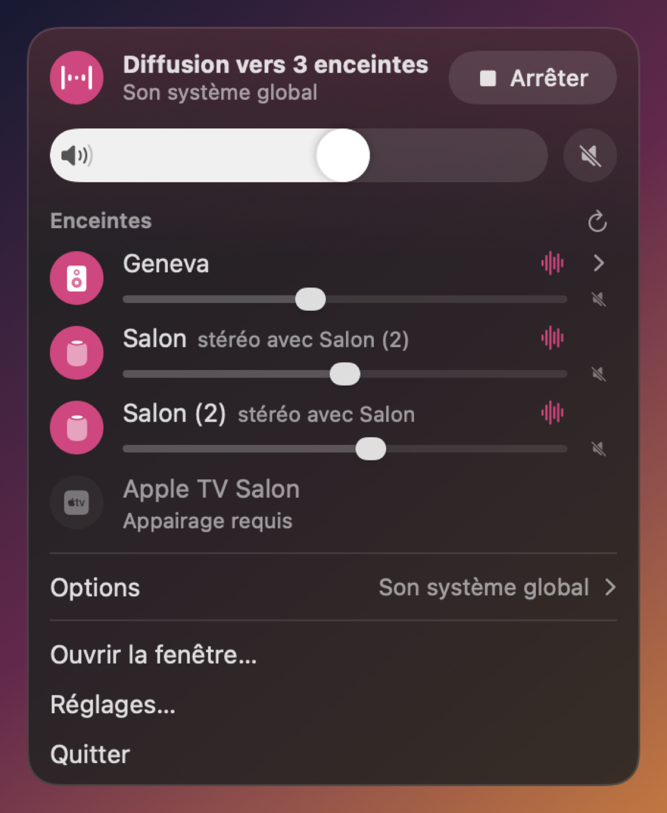
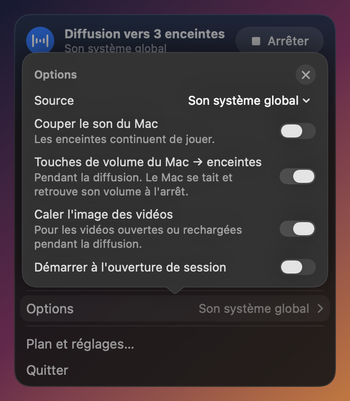
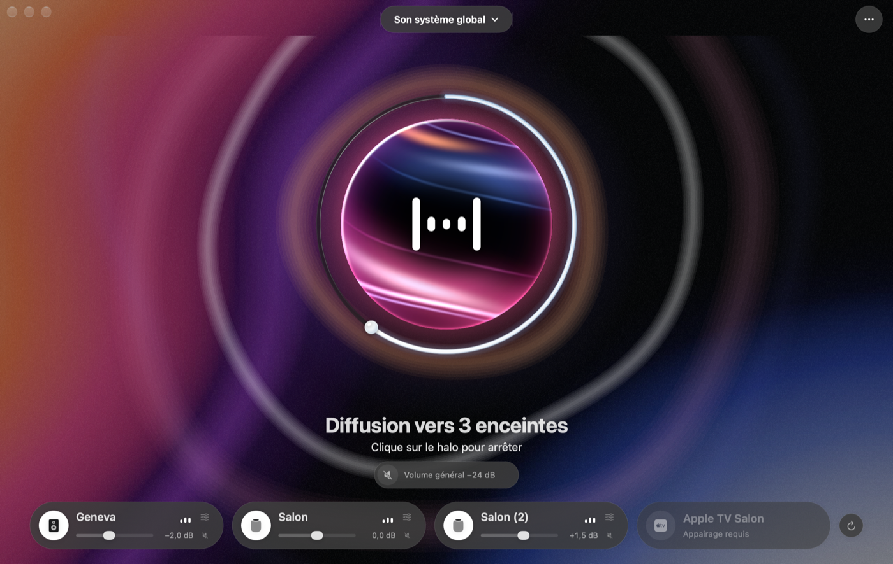
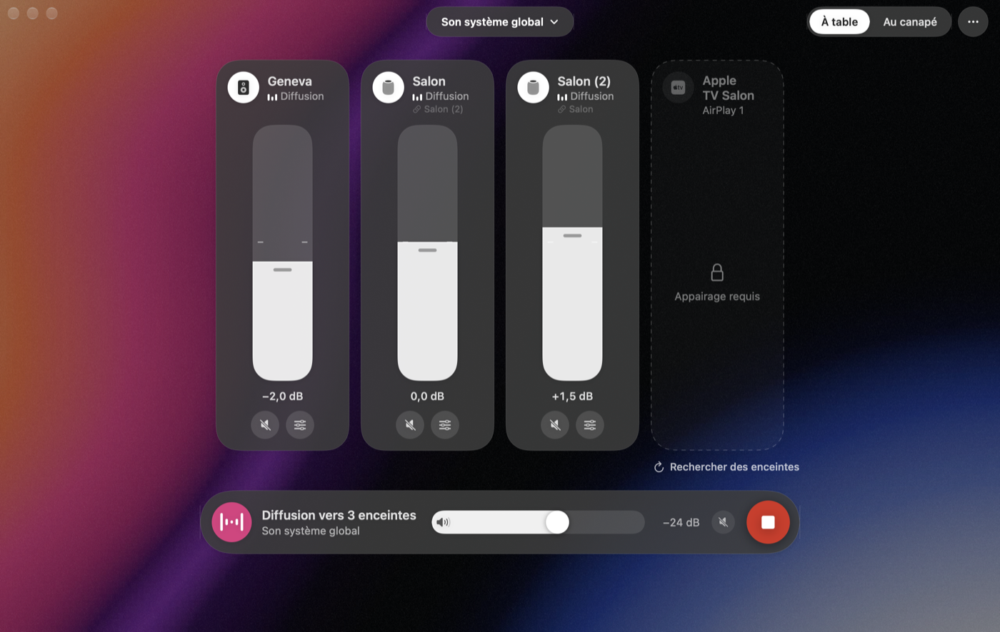
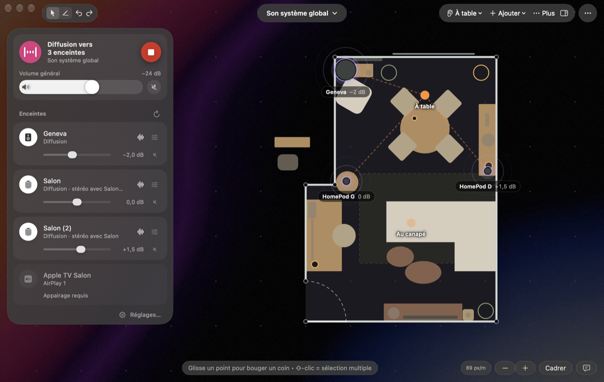
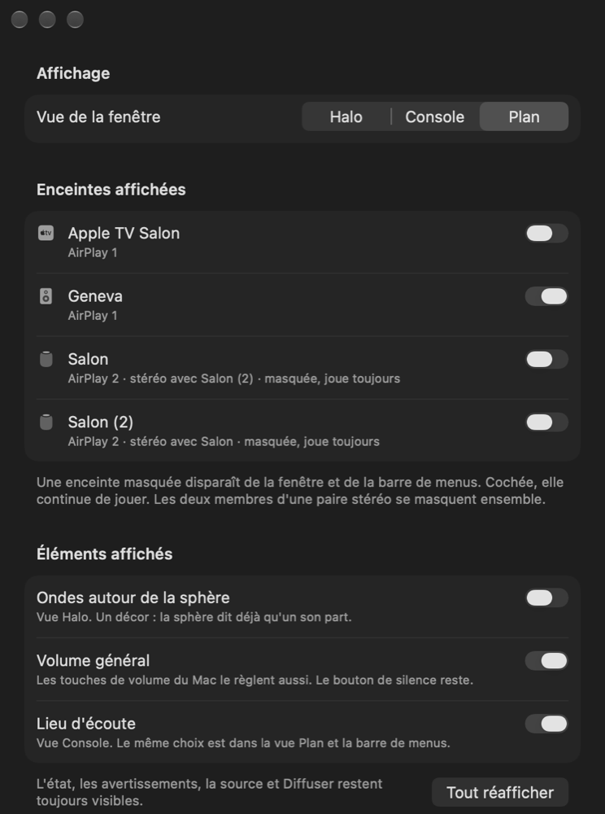

# AirPlay Personal Bridge

Application macOS native de diffusion audio multi-sortie, à usage strictement personnel.

Capture le son du Mac (système global, application précise, ou entrée physique) et le
diffuse **simultanément** vers une enceinte **AirPlay 1** (Geneva) et des enceintes
**AirPlay 2** (HomePod), avec volume indépendant par sortie et compensation du décalage
temporel entre elles. Elle se pilote depuis une icône dans la barre de menus : on coche une
enceinte, et ça joue dessus. Les vidéos lues sur le Mac restent calées sur le son des enceintes.

<p align="center">
  
  &nbsp;
  
</p>

<p align="center">
  
</p>

<p align="center">
  
</p>

<p align="center">
  
</p>

<p align="center">
  
</p>

*Rendus hors écran tirés du code, avec des données d'exemple (voir « Développement »). Le verre Liquid Glass ne
se rend pas hors écran : il y est remplacé par un aplat de même forme.*

## Pourquoi ce projet

macOS ne sait pas faire. Le périphérique de sortie multiple (Audio MIDI Setup) n'agrège pas
un appareil AirPlay 1 et un groupe AirPlay 2 simultanément. Airfoil y arrive en gérant
lui-même les deux protocoles en parallèle au lieu de s'appuyer sur le système : c'est
l'approche reprise ici, avec deux senders AirPlay implémentés en interne.

## État d'avancement

| Jalon | Contenu | État |
|---|---|---|
| -1 | Setup, émulateurs de récepteurs | ✅ validé contre mock |
| 0 | Validation OwnTone | ❌ abandonné : l'app native a répondu à sa question (ADR 010) |
| 1 | Capture Core Audio (3 modes + test DRM) | ✅ validé en local, à l'oreille |
| 2 | Sender RAOP (Geneva) | ✅ validé sur la vraie Geneva |
| 3 | Sender AirPlay 2 (HomePod) | ✅ validé sur les vrais HomePod, paire stéréo en deux sessions ; Apple TV appairée mais muette |
| 4 | Synchronisation et dérive | ✅ validé sur le matériel : ≤ 17 ms entre enceintes au micro, aucun écho à l'oreille |
| 5 | Interface et barre de menus | ✅ clos le 2026-11-02 sur le matériel |
| 5, suite | Calage vidéo, retard réduit à ~0,45 s, refonte Liquid Glass | 🔶 en cours depuis le 2026-11-09 : vu et entendu en partie, écoutes et mesures à finir |

**Ce qui joue réellement** : le 2026-11-02, depuis l'app, la Geneva et les deux HomePod ensemble, en vraie stéréo,
sans écho à l'oreille. Au micro, à table, les trois enceintes arrivent à moins de 17 ms les unes des autres, sous le
seuil de perception de 20 à 30 ms, sans aucun réglage manuel. Une heure de diffusion continue vers les trois enceintes :
0 erreur, dérive résiduelle sous 0,05 ms, plus de 5 000 paquets perdus sur le Wi-Fi tous renvoyés.

Depuis :

- **Vidéo** (2026-11-09) : image et son calés dans Dia sur les trois enceintes, vus par Baptiste sur une vidéo
  flash-bip et sur une vraie vidéo. Chrome 157 retarde bien son image de la latence que l'app annonce (mesuré).
- **Retard de bout en bout** (2026-11-09 et 10) : ramené de ~2,3 s à ~0,45 s. Les 0,25 s que les récepteurs ajoutaient
  sont compensés, mesuré au micro sur chaque enceinte (+290 ms → +40 à +47 ms, 6 ms d'écart entre enceintes). Le délai
  de restitution passe de 2 s à 0,4 s, choisi à l'oreille (0,3 s décroche).
- **Apple TV → Mac → enceintes** (2026-11-10) : avec le récepteur AirPlay du Mac allumé, l'Apple TV sort sur le Mac, et
  l'app relaie ce son vers les trois enceintes, Geneva comprise (entendu).

**Ce qui reste ouvert** :

- le palier de 0,4 s n'a été jugé qu'à l'oreille, quelques minutes, sans endurance, capture réseau ni mesure aux clics ;
- la nouvelle interface n'a été vue qu'en rendus hors écran ;
- la paire stéréo ouverte d'un seul geste n'a été validée que par les tests ;
- l'Apple TV ne restitue rien en direct ;
- les pannes provoquées et l'écoute au canapé restent à essayer.

Le détail, avec le niveau de preuve de chaque point, est dans [`PROGRESS.md`](PROGRESS.md).

## L'application

Prérequis : macOS 26+, Xcode, et l'OpenSSL de Homebrew pour compiler (`brew install openssl@3`). Il est
lié en statique : l'app n'en dépend plus à l'exécution.

```bash
scripts/setup-signing.sh            # une fois : identité de signature stable, sans aucune fenêtre
scripts/install-app.sh --open       # compile en Release, installe dans /Applications, lance

Drivers/APBOutput/build.sh          # pour caler les vidéos : compile et signe la sortie virtuelle
sudo scripts/install-driver.sh      # l'installe (mot de passe administrateur), relance coreaudiod
sudo scripts/uninstall-driver.sh    # la retire
```

Deux autorisations à donner une fois : **Réseau local**, sans quoi aucune enceinte n'apparaît, et
**Enregistrement des sons du système**, à la première diffusion. Grâce à l'identité stable, une
recompilation par ce script ne les révoque plus (vérifié le 2026-11-02). Le bouton Run
de Xcode signe en ad-hoc, sous un identifiant de bundle distinct en Debug, pour ne pas écraser
l'autorisation de l'app installée.

Dans la barre de menus :

- **Enceintes** : cocher ou décocher pendant une diffusion n'affecte pas les autres. Une enceinte qui
  exige un appairage est signalée, sans être cochée d'office. Une enceinte cochée mais éteinte reste affichée,
  « Introuvable sur le réseau — éteinte ? ».
- **Une paire stéréo de HomePod** se coche d'un seul geste, comme une enceinte : les deux membres entrent ensemble
  dans la diffusion, chacun ne joue que son canal. Chacun garde son propre volume, bien que la paire n'en ait qu'un
  côté HomePod : l'écart est appliqué dans le signal.
- **Volume** : un master, un réglage et un bouton silence par enceinte, et un silence général. Aucun silence ne
  déconnecte les enceintes. Pendant une diffusion, les touches volume et silence du Mac règlent le master, le Mac
  se tait, et il retrouve son réglage à l'arrêt.
- **Tonalité de la Geneva** : un tiroir sous sa rangée règle les basses (0 à +12 dB, protégées sous 30 Hz, sans
  pompage) et les aigus (0 à −9 dB). À 0 dB, le son est intact.
- **Icône** : elle ondule pendant une diffusion audible.
- **Écoute** : deux lieux sélectionnables, « À table » par défaut et « Au canapé ». Le lieu choisi compense
  la distance de chaque enceinte, en plus du réglage manuel.
- **Options** : source (système, application, entrée physique), « Couper le son du Mac », touches de volume du Mac,
  « Caler l'image des vidéos », démarrage à l'ouverture de session. Elles s'ouvrent dans une carte par-dessus le
  panneau, qui garde sa taille.

« Ouvrir la fenêtre… » ouvre la fenêtre, sombre, sans barre d'outils : tout flotte en verre sur un fond en dégradé
granuleux qui ondule lentement pendant une diffusion, et s'éteint au repos. La source est une pastille en haut au
centre, les options un bouton « … » en haut à droite. Trois vues, au choix dans les options ou les Réglages :

- **Halo** (par défaut) : une sphère de verre au centre, qui est le bouton Diffuser/Arrêter (⌘↩) et s'anime quand le
  son passe ; le volume général en anneau autour ; les enceintes en pastilles dessous ;
- **Console** : une tuile et un curseur vertical par enceinte, et une barre de lecture (état, volume général,
  silence, Diffuser/Arrêter) ;
- **Plan** : le plan de la pièce à l'échelle en plein cadre, le panneau des enceintes flottant à gauche, l'inspecteur
  de l'objet sélectionné à droite.

Le délai, la tonalité et l'adresse d'une enceinte se règlent dans une fenêtre surgissante, et le diagnostic s'ouvre
depuis les options.

**Masquer** : un clic droit sur une enceinte, ou l'œil barré qui apparaît au survol, la retire des trois vues et du
panneau de la barre de menus (une Apple TV qui ne joue pas, par exemple). C'est seulement visuel : cochée, elle
continue de jouer. Une paire stéréo se masque d'un bloc. Une ligne « 1 enceinte masquée » le rappelle.

**Réglages** (⌘,) : le choix de la vue, un interrupteur par enceinte connue pour la réafficher, et trois éléments
masquables (les ondes de la vue Halo, le volume général, le lieu d'écoute de la Console).

L'app reste active fenêtre fermée et quitte alors le Dock.

**En quittant**, l'app ferme les sessions des enceintes et arrête la capture. Elle rend ensuite au Mac sa sortie, son
volume et son silence, puis relance `coreaudiod`. **Le son du Mac se coupe alors une à deux secondes**, y compris à chaque
réinstallation par `install-app.sh`. Sans la règle sudoers que pose `install-driver.sh`, cette relance est sautée et l'app
quitte quand même.

## Caler l'image des vidéos

Pendant une diffusion, les applications jouent sur une sortie du Mac qui annonce quelques millisecondes de latence, alors
que le son sort des enceintes ~0,45 s plus tard : sans correction, l'image part en avance. Le pilote
[`Drivers/APBOutput`](Drivers/APBOutput/README.md) ajoute une sortie virtuelle, « AirPlay Personal Bridge », qui jette le
son et annonce ce retard aux applications. Pendant une diffusion, l'app en fait la sortie par défaut du Mac et rend
l'ancienne à l'arrêt, ou au lancement qui suit un plantage. Le son réel est capté par le Process Tap, en amont : **rien ne
change sur le fil**.

- Chromium (Dia, Chrome) et AVFoundation retardent l'image de la latence annoncée.
- Cette latence est lue à l'ouverture du flux : **une page ouverte avant la diffusion doit être rechargée**.
- En capture d'une application précise, les autres applications jouent sur la sortie virtuelle, donc se taisent.
- Option « Caler l'image des vidéos », active par défaut. Un choix de sortie fait en pleine diffusion (un casque) est
  respecté.

## Architecture

Process unique, natif Swift. **Aucune dépendance runtime à un sous-processus externe** :
OwnTone et pyatv servent au développement et au pairing initial, jamais à l'exécution.

```
                  ┌────────────────────┐
   Process Tap ──▶│                    │──▶ ring buffer ──▶ Sender RAOP      ──▶ Geneva
   ou entrée      │  Capture (1 seule  │      lock-free
   physique       │  active à la fois) │──▶ ring buffer ──▶ Sender AirPlay 2 ──▶ HomePod
                  └────────────────────┘      lock-free      (un par sortie)
```

Deux règles structurantes : la capture ne connaît **jamais** les destinations, et chaque
sender ignore l'existence de l'autre. Le flux PCM est dupliqué en lecture seule ; aucun
sender ne modifie le buffer partagé.

L'ensemble des invariants est listé dans [`CLAUDE.md`](CLAUDE.md) et en section 12 du
cahier des charges — ils ne sont pas négociables, y compris pour un développement assisté
par agent.

### Organisation du dépôt

```
AirplayPersonalBridge/      l'app SwiftUI (Xcode) : barre de menus, plan, réglages
Sources/AudioCore/          bibliothèque cœur (moteur, capture, senders) — sans interface
  ├── RAOP/                 sender AirPlay 1 + socle partagé (RTSP, UDP, RTP, resampling)
  ├── AirPlay2/             sender AirPlay 2 (pairing, canal chiffré, RTSP, événements)
  │   └── Crypto/           wrappers Swift des primitives C
  ├── DSP/                  tonalité de la Geneva
  └── Sync/                 horloge commune, latences, mesure de timing, correction de dérive
Sources/CCrypto/            bibliothèques C vendues (SRP, X25519, Ed25519, ChaCha20-Poly1305)
Sources/audiocap/           exécutable CLI de validation (dump .wav, diffusion, mesures)
Drivers/APBOutput/          sortie virtuelle Core Audio (AudioServerPlugIn en C) du calage vidéo
Tests/                      tests du cœur et de l'app
scripts/                    signature, installation de l'app et du pilote, mesures, icône
docs/                       cahier des charges, guides, prompts des sessions de test, captures d'écran
tools/                      émulateurs et venvs Python (gitignoré)
```

Les primitives cryptographiques d'AirPlay 2 ne sont **jamais réécrites en Swift** : quatre
bibliothèques C éprouvées sont vendues telles quelles et pilotées par des wrappers dédiés
qui gèrent leur mémoire. Une erreur de portage (endianness, off-by-one) casserait la
compatibilité sans symptôme visible en test. Provenance, commits et écarts :
[`Sources/CCrypto/README.md`](Sources/CCrypto/README.md).

## Développement

```bash
git clone https://github.com/Erkin0xx/AirplayPersonalBridge.git
cd AirplayPersonalBridge
./setup.sh       # Homebrew, mocks, pyatv — idempotent

swift build      # compile le cœur, le CLI et toute l'app, sauf son point d'entrée
swift test       # tests du cœur et de l'app
```

Seul `xcodebuild` compile le point d'entrée `@main` de l'app.

Les images de ce README se régénèrent sans lancer l'app :

```bash
MENUBAR_PNG_DIR=<dossier> swift test --filter MenuBarPanelExport   # le panneau, chaque situation
WINDOW_PNG_DIR=<dossier>  swift test --filter MainWindowExport     # la fenêtre, chaque situation
```

### Lancer les émulateurs de récepteurs

Deux récepteurs logiciels tiennent lieu de cibles de test :

```bash
./run-mocks.sh          # lance les deux mocks + vérifie annonce Bonjour et port
./run-mocks.sh check    # vérifie seulement
./run-mocks.sh restart  # arrête puis relance
./run-mocks.sh stop     # arrête les mocks lancés par ce script
```

| Mock | Émule | Outil | Service |
|---|---|---|---|
| `Geneva-Mock` | l'enceinte Geneva (AirPlay 1) | shairport-sync | `_raop._tcp` |
| `ApTV-HomePod-Mock` | un récepteur AirPlay 2 | airplay2-receiver | `_airplay._tcp` |

> ⚠️ **Le récepteur AirPlay natif de macOS doit rester désactivé** (Réglages Système >
> Général > AirDrop et Handoff). Il occupe le port 5000 et empêche shairport-sync de
> démarrer ; l'option `-p` est ignorée par cette build.

> Les mocks apparaissent comme des enceintes dans l'app : les arrêter avant d'écouter le vrai matériel.

### Valider en ligne de commande

Sans autorisation ni bundle, une sinusoïde à la place de la capture (−50 dBFS par défaut) :

```bash
swift run audiocap --tone --airplay Geneva-Mock --volume -30 10
swift run audiocap --browse     # récepteurs AirPlay 1 (_raop._tcp)
swift run audiocap --browse2    # récepteurs AirPlay 2 (_airplay._tcp), avec leurs bits
swift run audiocap --video-sync # sortie virtuelle présente ? latence annoncée ? sortie par défaut ?
```

`--browse2` affiche les **bits de fonctionnalité** annoncés par le récepteur, dont son mode
de pairing. C'est la première commande à lancer devant un récepteur inconnu.

Avec la vraie capture, passer par le bundle :

```bash
./make-cli-bundle.sh                          # compile + signe + enregistre le bundle

./audiocap --list                             # process audio (● = en train de jouer)
./audiocap 10 systeme.wav                     # son système global
./audiocap --app Music 10 music.wav           # une application précise
./audiocap --mode input 10 entree.wav         # entrée physique (micro/ligne)
./analyse-wav.py systeme.wav                  # son capté ? silence ? fichier vide ?

./audiocap --airplay Geneva --airplay2 Salon --airplay2 "Salon (2)" 30   # plusieurs sorties
./audiocap --airplay Geneva --volume -15 30                  # volume (--volume2 pour l'autre)
./audiocap --airplay Geneva --airplay2 Salon --delay2 25 30  # décalage manuel, en ms
./audiocap --airplay Geneva --mute-local 30                  # coupe le son du Mac
```

`--airplay2` se répète, et `--volume2`, `--delay2` et `--credentials2` aussi, dans le même ordre. Codes de sortie de `./audiocap` : 0
succès, 1 erreur, 2 silence numérique ou mauvais usage, 3 autorisation refusée, 130 après Ctrl-C.

Mesurer le calage au micro du Mac, et tester gauche/droite :

```bash
./audiocap --clicks --airplay Geneva --airplay2 Salon --record-input mesure.wav 60   # salves datées
scripts/measure-clicks.py mesure.wav                                                 # écart par enceinte
VOLUME=-10 scripts/measure-receiver-latency.sh   # chaque enceinte, avec et sans compensation (~11 min)
./audiocap --channel-test --airplay2 Salon 30    # bip grave à gauche, deux aigus à droite
```

`--receiver-latency` et `--receiver-latency2` règlent la compensation de l'ajout des récepteurs (0 rend le fil
d'avant le 2026-11-09). `--video-latency <s|auto>` et `--default-output <uid|bridge>` pilotent la sortie virtuelle à la
main.

**Toujours passer par `./audiocap`**, jamais par le binaire interne du bundle : macOS
attribue l'autorisation à l'identité de l'**app**, et un binaire lancé directement depuis le
shell n'en hérite pas — le tap renvoie alors du silence sans la moindre erreur.

> ⚠️ **Autorisation requise, et ce n'est pas celle du micro.** Le Process Tap dépend de
> « Enregistrement des sons du système » (`kTCCServiceAudioCapture`), distincte de
> « Microphone ». Sans elle, le tap **ne renvoie aucune erreur** : il livre des buffers de
> silence numérique, ce qui ressemble trompeusement à un blocage DRM.
>
> Réglages Système > Confidentialité et sécurité > « Enregistrement de l'écran et des sons
> du système » > section « Enregistrement des sons du système uniquement » > **+**.

### Le DRM bloque-t-il la capture ?

**Non, d'après les mesures du jalon 1.** Apple Music et une vidéo Netflix ont été captés
sans blocage (99,1 % et 96,0 % d'échantillons non nuls, fichiers relus à l'oreille). Le DRM
protège le fichier chiffré, pas les échantillons PCM déjà décodés quand ils atteignent le
graphe Core Audio. Détail des mesures dans [`PROGRESS.md`](PROGRESS.md).

### Méthode de travail

Le travail se fait jalon par jalon. Chaque jalon se clôt par une mise à jour de
`PROGRESS.md`, un commit qui le référence, et un point d'arrêt — jamais d'enchaînement
automatique sur le suivant.

Toute session de travail (humaine ou agent) commence par lire [`PROGRESS.md`](PROGRESS.md)
et [`CLAUDE.md`](CLAUDE.md) : ces deux fichiers et l'historique git constituent la seule
mémoire du projet d'un jalon à l'autre.

## Synchroniser les sorties

Les sorties partagent une **horloge de restitution commune** : elle traduit un numéro de trame de
capture en instant de restitution attendu, et chaque sender en tire l'ancrage NTP qu'il annonce au
récepteur. C'est le récepteur qui cale sa restitution dessus — le mécanisme natif d'AirPlay, pas une
mesure de trajet réseau. Aucun sender ne sait que les autres existent. Les vrais récepteurs honorent cet
ancrage : moins de 17 ms entre enceintes au micro.

**Le délai de restitution vaut 0,4 s**, et c'est la seule constante : la latence annoncée par chaque sender,
l'ancrage et la latence de la sortie virtuelle en découlent. Les récepteurs ajoutent 11 025 trames (0,25 s) à la
latence qu'on leur annonce : elles en sont retranchées. Le retard de bout en bout est donc d'environ 0,45 s, contre
~2,3 s jusqu'au 2026-11-09. Si le son craque sur un Wi-Fi chargé, remonter le délai à 0,5 s
(`SharedPlaybackClock.defaultPlayoutDelaySeconds`). Raisonnement et mesures :
[`docs/retard_2s_notes.md`](docs/retard_2s_notes.md).

Le décalage manuel et la compensation du lieu d'écoute n'insèrent aucun échantillon : ils décalent
l'instant annoncé, donc s'appliquent sans rupture de flux. Ils restent un fine-tune et un filet de
sécurité, en complément de l'alignement automatique — pas à sa place.

La **dérive** entre l'horloge du périphérique audio (qui cadence la capture) et celle de
l'hôte (qui cadence l'émission) est corrigée par ajout ou suppression d'**une** trame, avec
un fondu de 32 trames — la technique de Snapcast.

## Documentation

- [Cahier des charges](docs/cahier_des_charges_diffusion_audio.md) — périmètre,
  architecture, invariants, jalons.
- [Guide d'installation et de tests](docs/guide_installation_et_tests.md) — mise en place
  des émulateurs, checklists de validation par jalon.
- [Prompt des tests matériels](docs/prompt_tests_materiel.md) — le déroulé des essais sur le vrai
  matériel et la clôture du jalon 5.
- [Prompt vidéo, Dia et Airfoil](docs/prompt_video_dia_airfoil.md) et [prompt du retard](docs/prompt_retard_2s.md) —
  les deux chantiers ouverts après la clôture, et [leurs notes de mesure](docs/retard_2s_notes.md).
- [Sortie virtuelle](Drivers/APBOutput/README.md) — le pilote du calage vidéo : ce qu'il expose, installation, temps
  réel.
- [`CLAUDE.md`](CLAUDE.md) — invariants recopiés littéralement et faits vérifiés sur la
  machine de dev (formats, pièges d'API, chemins de config).
- [`PROGRESS.md`](PROGRESS.md) — journal par jalon.

## Limites connues

- **AirPlay 2 est un protocole propriétaire non documenté.** La logique portée depuis
  OwnTone/pyatv peut cesser de fonctionner après une mise à jour tvOS ou HomePod, sans
  préavis ni recours.
- **Les émulateurs ne prouvent rien sur le matériel réel.** `airplay2-receiver` est
  expérimental de son propre aveu : un handshake qui passe contre lui est un signal de
  départ, pas une garantie contre le vrai firmware Apple.
- **0,4 s de délai laisse peu de marge aux retransmissions.** Avec un tampon de 2 s, les HomePod redemandaient un
  paquet perdu ~95 ms après son envoi en médiane, jusqu'à ~1 s au pire : un Wi-Fi chargé peut faire craquer le son.
- **L'Apple TV ne restitue rien en direct** : `pair-verify` aboutit et la session est acceptée, mais aucun son ne
  sort, pas plus qu'avec pyatv. Le détour par le récepteur AirPlay du Mac fonctionne, mais ce récepteur occupe le
  port 5000 et empêche alors les mocks de démarrer.
- **Deux sessions vers une paire stéréo ouvertes à des moments différents s'expulsent mutuellement** : c'est pourquoi
  la paire s'ouvre d'un seul geste.
- **Le calage vidéo dépend de ce que lit le lecteur.** Une page ouverte avant la diffusion doit être rechargée. Si
  Chromium passe un jour à son chemin AVFoundation (désactivé par défaut sous macOS 27), il ne retardera plus l'image.
- **La sortie virtuelle s'installe avec le mot de passe administrateur**, et chaque installation comme chaque
  fermeture de l'app coupe le son du Mac une à deux secondes.
- **Le debug est limité au-delà du handshake** : le trafic AirPlay 2 est chiffré.
- **La mesure de décalage d'horloge n'a jamais produit de valeur** : shairport-sync envoie ses
  requêtes de timing à zéro. Le code est en place et testé, il attend un récepteur qui
  remplisse le champ.
- **Le contenu des événements AirPlay 2 n'est pas interprété** : ils sont déchiffrés et acquittés,
  sans refléter dans l'app un volume changé depuis le récepteur.
- Le binaire exige macOS 26, plancher imposé par l'OpenSSL lié en statique.
- Pas de spatialisation 3D, pas de portage vers un autre OS, pas de fonction récepteur :
  l'application est un sender exclusivement (section 3 du CDC).

## Licence

Projet personnel, non distribué.
